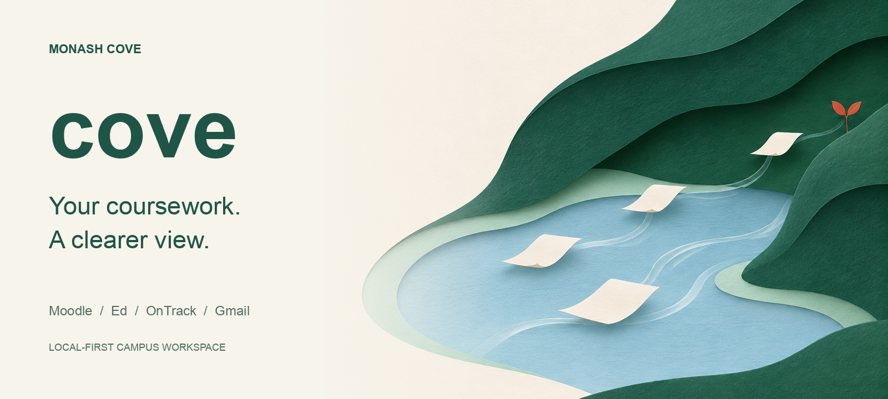
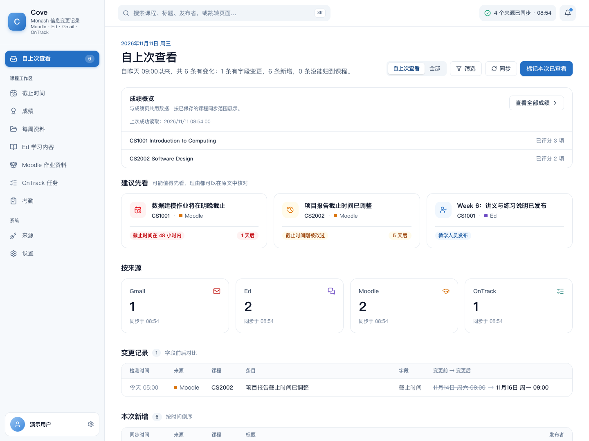
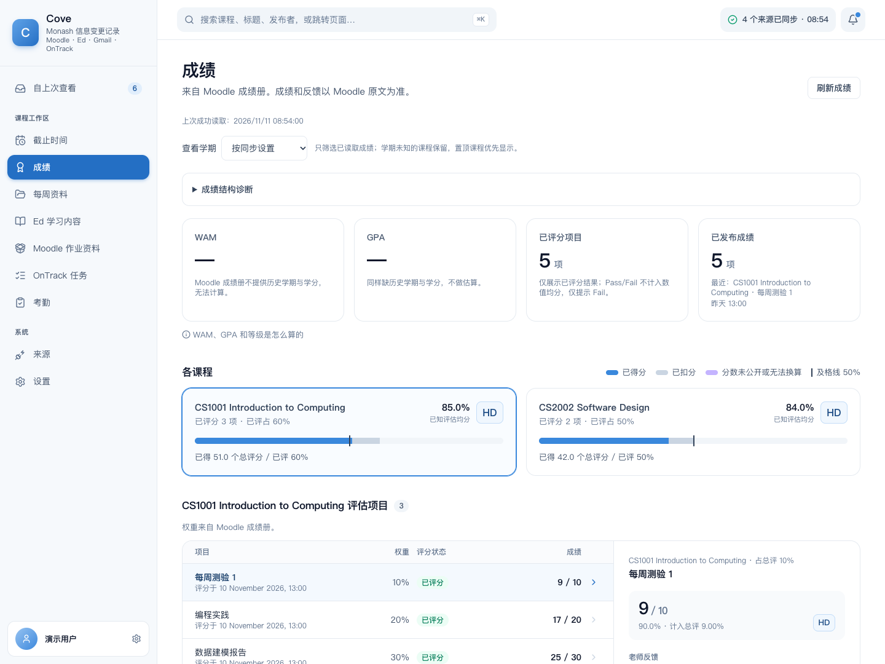
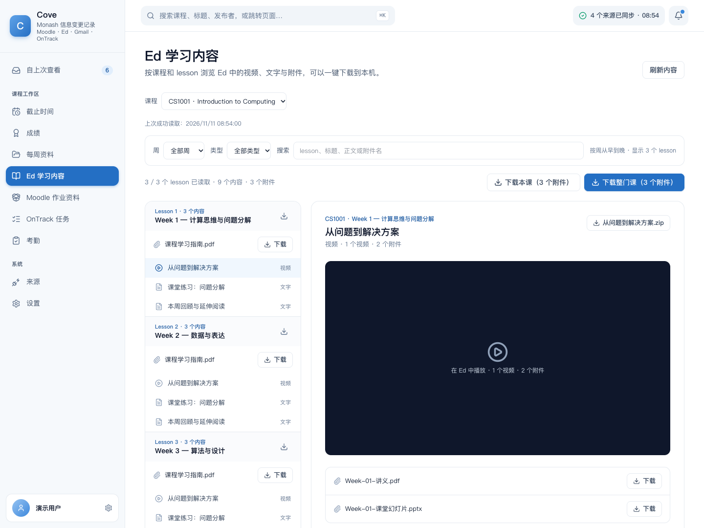
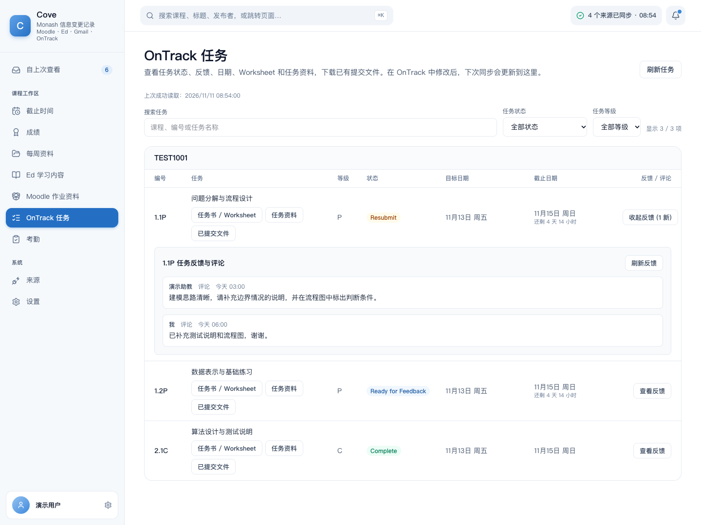
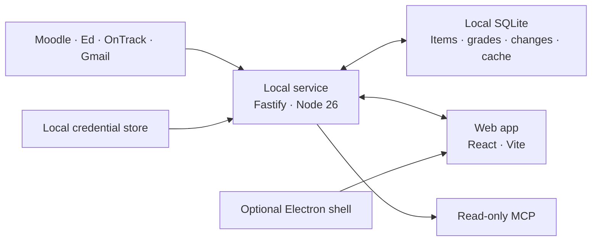

<p align="center">
  
</p>

<h1 align="center">Monash Cove</h1>

<p align="center"><strong>Your courses, changes and next steps. In one place.</strong></p>
<p align="center">A local-first workspace for Monash students using Moodle, Ed, OnTrack and Gmail.</p>

<p align="center">
  <strong>English</strong> · <a href="README.zh-CN.md">简体中文</a><br />
  <a href="#quick-start">Quick start</a> · <a href="#see-it-in-action">Preview</a> · <a href="docs/README.md">Documentation</a>
</p>

<p align="center">
  
  
  
</p>

A changed deadline, a new worksheet, a tutor's comment: useful information arrives in different places. Cove brings it into a reviewable brief, keeps the source evidence, and records what changed since your last visit.

## See it in action



*Screenshots show the running application with anonymous demonstration data. The banner is AI-generated brand artwork; the product screens are captured from the real UI.*

<details>
<summary><strong>Grades — published results and category breakdowns</strong></summary>



Reads Moodle Grades and assessment weights, distinguishes numeric and Pass/Fail results, and keeps the last successful data visible when a refresh fails.

</details>

<details>
<summary><strong>Ed — lessons, recordings and attachments</strong></summary>



Browse lessons in natural week order. Find PDFs attached to videos, native PDF slides and lesson-outline files; search by filename or package a lesson for download.

</details>

<details>
<summary><strong>OnTrack — tasks, feedback and worksheets</strong></summary>



Search tasks, filter by status or grade band, read feedback in place, and download worksheets, task resources and existing submission files.

</details>

## Quick start

Use **Node.js 26+**, **Google Chrome** for the login assistants, and your **Monash account**. macOS is the verified platform; Windows desktop packages have not been tested on real Windows hardware.

```bash
git clone https://github.com/jackdsjk/Monash-Cove.git
cd Monash-Cove
./start-cove.sh
```

The script installs missing dependencies, builds missing production output, and serves the app at **<http://127.0.0.1:4317/>**. macOS opens the browser automatically. After pulling updates, rebuild both packages if their production output already exists; the launcher does not detect stale builds.

1. Connect the sources you use in **Setup** or **Sources**. You can skip setup and connect later.
2. For Gmail, configure your Google OAuth client in `local-service/.env.local` using [the example](local-service/.env.example). Other source connections do not require Gmail.
3. Run **Full sync** in **Settings**, then return to the brief. The local service also schedules background sync while it is running.

New databases start empty. Demonstration data requires an explicit fixture setting; failed or disconnected sources never trigger example data.

For desktop packaging, signing and installation limits, read the [desktop guide](docs/desktop-install.md). Current unsigned builds are for controlled testing; this README does not offer a ready-to-distribute signed release.

## What you can do

| Workflow | Available now |
|---|---|
| **Catch up on changes** | A brief since your last visit, course/source filters, quoted evidence and original links. Field-level history tracks deadline, title, course and body changes for 90 days. |
| **Track coursework** | Moodle and OnTrack deadlines, countdowns and a shared completed/submitted state. Completed items leave the active deadline list. |
| **Check grades** | Published Moodle scores, category weights, independent Overview text and grade-change notices. Pass/Fail scales stay separate from numeric averages; unknown weights remain unknown. |
| **Collect Moodle materials** | Week/section, type and search filters; batch downloads. The assignment pack includes only Moodle activities confirmed by Grades. |
| **Study from Ed** | Week ordering, content/file filters, filename search, videos and independent PDF/PPT attachments. Downloads report actual successes and failures. |
| **Follow OnTrack feedback** | Definition-first task lists, natural numbering, state/grade filters and on-demand comment threads. Worksheets and resources stay with their tasks. |
| **Review attendance** | Codes from Gmail and Moodle, local image OCR, and a separate explicit submission flow. |
| **Connect another client** | Read-only local MCP access to briefs, changes, deadlines, Moodle materials, Ed lessons and OnTrack tasks/feedback. [MCP setup](docs/mcp.md). |

Shared queries and account-scoped SQLite snapshots keep successfully read data visible during refresh or network failure. Moodle semester, hidden-course and pinned-course preferences control bulk material and grade reads.

## Sources and data boundaries

| Source | Connection | Reads |
|---|---|---|
| **Moodle** | Chrome login assistant; durable session cookies with periodic maintenance | Courses, grades, assessments, materials and available forum content |
| **Ed** | API token | Course discussions, replies, lessons and attachments |
| **OnTrack** | Chrome login assistant; refresh credential exchanged for short-lived tokens | Accessible projects, task definitions, feedback and files |
| **Gmail** | Google OAuth with `gmail.readonly` | Mail and threads |

School-enforced session expiry can still require reconnection. OnTrack history is limited to content the account can currently access; hidden or deleted records cannot be recovered.

**Local by default.** The service owns the database and source credentials; the browser does not store source secrets. macOS uses Keychain, with a restricted-permission local file fallback on other platforms. The default database is `~/Library/Application Support/Cove/cove.sqlite`; configuration can change its location.

**Optional model access.** Triage uses local rules unless `COVE_MODEL_BASE_URL`, `COVE_MODEL_NAME` and `COVE_MODEL_API_KEY` are configured. Enabling a remote model sends item titles, text and source/author-role fields to that endpoint. An external MCP client can also receive the data it requests. Choose those integrations with your data preferences in mind.

**School-side actions.** Normal browsing, sync and file reads do not change task state, post comments or submit coursework. Attendance has a dedicated submission flow. Cove does not send email, change grades or submit assignments.

## How it fits together



The root **`webapp/`** and **`local-service/`** are the active local application. **`desktop/`** wraps them for desktop use. **`demo/`** is an anonymous static prototype. **`stack/unicorn/`** is a separate, independently maintained memory-layer repository; it is not required to start the local app.

## Development

For development, start `local-service` before the Web App:

```bash
# Terminal 1
cd local-service
npm ci
npm run dev
```

```bash
# Terminal 2
cd webapp
npm ci
npm run dev
```

Open <http://127.0.0.1:5174/>. Vite proxies `/api` to the local service on port 4317.

| Check | Command |
|---|---|
| Backend tests and build | `cd local-service && npm run check` |
| Frontend data, types and build | `cd webapp && npm run check` |
| Frontend unit tests | `cd webapp && npm exec vitest run` |
| Isolated browser smoke | `cd webapp && npm run e2e` |

Browser smoke uses temporary data and credentials, blocks external network access and covers first-run, failure, filtering and download flows. Fixtures verify behavior; they do not prove every real-account course or attachment works. [Verification and reuse report](docs/unicorn-feature-reuse-2026-11-11.md).

## Status and limits

Cove is built for a single Monash student on one machine. Source connections and selected data paths have been checked against real accounts; broader coverage and failures are documented in the [audit reports](docs/README.md). Screenshots are demonstrations, not records of real student results.

- macOS desktop builds remain unsigned; public distribution needs signing/notarization and a review of packaged OAuth configuration. Windows hardware verification is outstanding.
- OnTrack's date-only deadlines use the Malaysia campus time convention. Other campuses need timezone review.
- Study advice is deferred. WAM/GPA are not estimated without the required historical results and credit data.
- There is no shared cloud account, cross-device sync or external user-study validation.

## Documentation

[All documentation](docs/README.md) · [Web App](webapp/README.md) · [Local service](local-service/README.md) · [Desktop installation](docs/desktop-install.md) · [MCP access](docs/mcp.md)

For implementation details: [cache behavior](docs/muster-reuse-and-cache-2026-11-10.md), [grading rules](docs/muster-grading-rules-2026-11-11.md), and [Unicorn/Ed/OnTrack reuse](docs/unicorn-feature-reuse-2026-11-11.md).

## License and acknowledgements

An overall open-source license has not yet been selected for this repository. Public source availability does not grant a general reuse license.

Vendored components keep their own licenses and notices, including [Muster grading](webapp/src/lib/muster/README.md), [Ed lesson extraction](local-service/src/vendor/edstem-cli/README.md) and [OnTrack status labels](webapp/src/vendor/ontrack-cli/README.md). Additional OnTrack reuse and its Apache-2.0 source are recorded in the [integration report](docs/always-ontrack-reuse-2026-11-11.md).
