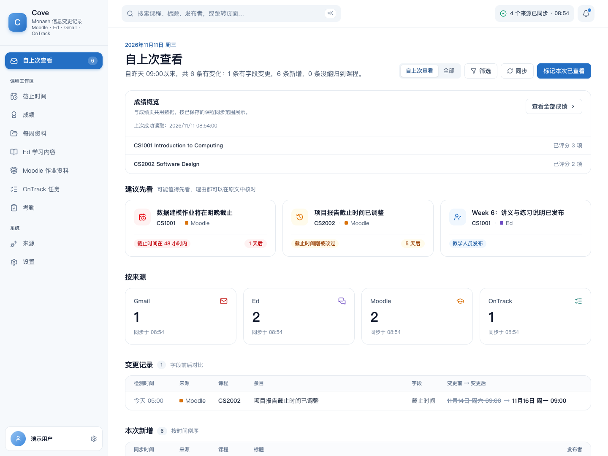
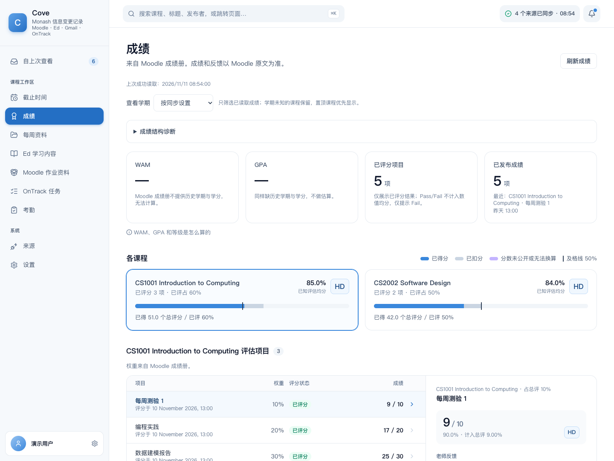
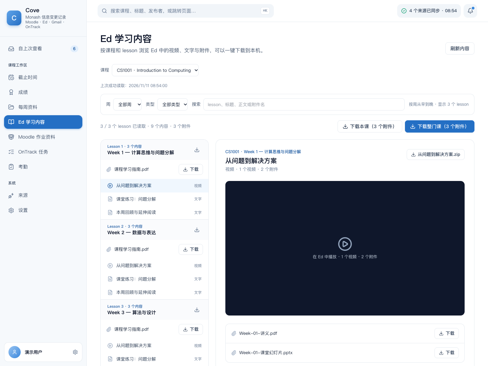
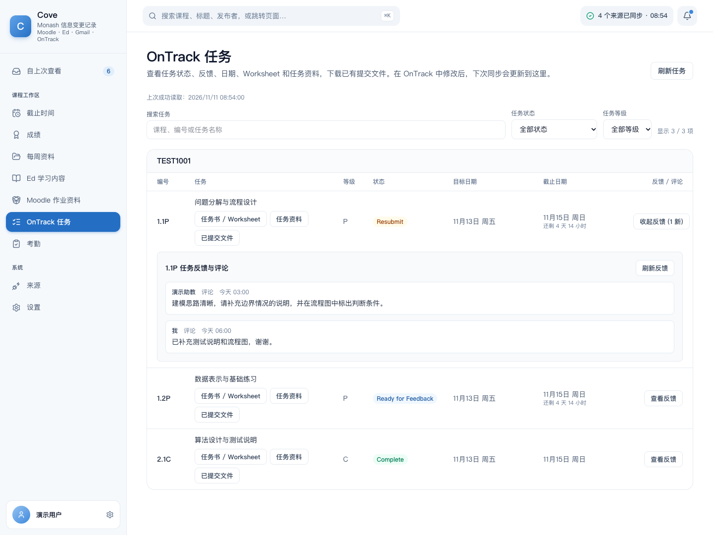
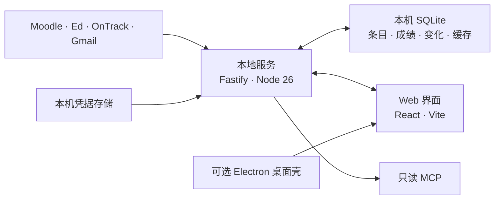

<p align="center">
  
</p>

<h1 align="center">Monash Cove</h1>

<p align="center"><strong>课程、变化与下一步，在一处看清。</strong></p>
<p align="center">面向 Monash 学生的本地优先工作台，连接 Moodle、Ed、OnTrack 与 Gmail。</p>

<p align="center">
  <a href="README.md">English</a> · <strong>简体中文</strong><br />
  <a href="#快速开始">快速开始</a> · <a href="#界面预览">界面预览</a> · <a href="docs/README.md">文档</a>
</p>

<p align="center">
  
  
  
</p>

截止时间改了、新的 Worksheet 发布了、导师留下反馈了——有用的信息散落在不同平台。Cove 把它们汇成一份可核对的简报，保留原文证据，并记录自上次查看后发生的变化。

## 界面预览



*截图来自实际运行的应用，使用匿名演示数据。顶部横幅为 AI 生成的品牌插画，产品界面为真实 UI 截图。*

<details>
<summary><strong>成绩：已发布结果与分类明细</strong></summary>



读取 Moodle Grades 和评估权重，区分数值与 Pass/Fail 成绩；刷新失败时保留上次成功读取的数据。

</details>

<details>
<summary><strong>Ed：学习内容、录像与附件</strong></summary>



按周自然排序，查找视频中的 PDF、原生 PDF 和 lesson 提纲附件；支持文件名搜索与单个 lesson 打包下载。

</details>

<details>
<summary><strong>OnTrack：任务、反馈与 Worksheet</strong></summary>



搜索任务，按状态或等级筛选，直接查看反馈，下载 Worksheet、任务资料和已有提交文件。

</details>

## 快速开始

准备 **Node.js 26+**、登录助手使用的 **Google Chrome**，以及你的 **Monash 账号**。当前已验证平台为 macOS；Windows 桌面包尚未在真实 Windows 硬件上测试。

```bash
git clone https://github.com/jackdsjk/Monash-Cove.git
cd Monash-Cove
./start-cove.sh
```

脚本安装缺失的依赖、构建尚不存在的生产产物，然后在 **<http://127.0.0.1:4317/>** 提供界面；macOS 会自动打开浏览器。拉取更新后，如果生产产物已经存在，请重新构建前后端；启动脚本不会判断已有构建是否过期。

1. 在「首次设置」或「来源」连接需要的平台，也可以跳过、稍后连接。
2. Gmail 需要按[配置示例](local-service/.env.example)在 `local-service/.env.local` 填写自己的 Google OAuth client；其他来源不依赖 Gmail。
3. 在「设置」运行「全量同步」，然后回到简报。本地服务运行时也会按计划执行后台同步。

新数据库默认空数据。演示数据必须显式启用；来源失败或断开不会触发灌入示例。

桌面打包、签名与安装限制见[桌面指南](docs/desktop-install.md)。现有未签名构建用于受控测试，本页不提供可直接公开分发的签名版本。

## 可以做什么

| 工作流 | 当前能力 |
|---|---|
| **查看变化** | 自上次查看的简报、课程／来源筛选、原文引文和来源链接；截止时间、标题、课程与正文的字段变化保留 90 天。 |
| **跟进作业** | 汇总 Moodle 与 OnTrack 截止日期、倒计时及统一的完成／已提交状态；完成事项移出当前截止列表。 |
| **检查成绩** | Moodle 已发布分数、分类权重、独立 Overview 原文和成绩变化提示；Pass/Fail 与数值均分分开，未知权重保持未知。 |
| **整理 Moodle 资料** | 周／板块、类型与搜索筛选，批量下载；作业资料包仅包含经 Grades 确认的 Moodle 活动。 |
| **阅读 Ed 内容** | 周排序、内容／文件筛选、文件名搜索、视频与独立 PDF/PPT 附件；下载按实际结果报告成功与失败。 |
| **查看 OnTrack 反馈** | 定义优先的任务目录、自然编号、状态／等级筛选与按需评论线程；Worksheet 和资源跟随所属任务。 |
| **核对考勤** | Gmail 与 Moodle 考勤码汇总、本地图片 OCR，以及独立的显式提交流程。 |
| **连接其他客户端** | 通过本地只读 MCP 读取简报、变化、截止日期、Moodle 资料、Ed lesson 与 OnTrack 任务／反馈。[接入说明](docs/mcp.md)。 |

页面共享查询和按账号隔离的 SQLite 快照让已成功读取的数据在刷新或网络失败时继续显示。Moodle 的学期、隐藏与置顶课程偏好控制批量资料和成绩读取范围。

## 来源与数据边界

| 来源 | 连接方式 | 读取内容 |
|---|---|---|
| **Moodle** | Chrome 登录助手；持久 Cookie 与定期会话维护 | 课程、成绩、评估、资料和可访问的论坛内容 |
| **Ed** | API token | 课程讨论、回复、lesson 与附件 |
| **OnTrack** | Chrome 登录助手；刷新凭据换取短时 token | 可访问项目、任务定义、反馈和文件 |
| **Gmail** | Google OAuth，使用 `gmail.readonly` | 邮件与线程 |

学校强制会话到期后仍可能需要重连。OnTrack 历史仅限账号当前可访问内容，不能恢复已隐藏或删除的记录。

**默认本地处理。** 数据库和来源凭据由本地服务管理，浏览器不存储来源密钥。macOS 使用 Keychain，其他平台使用受限文件权限的本地凭据存储。默认数据库为 `~/Library/Application Support/Cove/cove.sqlite`，可通过配置更改路径。

**可选模型接入。** 未配置 `COVE_MODEL_BASE_URL`、`COVE_MODEL_NAME` 和 `COVE_MODEL_API_KEY` 时，分诊使用本地规则。启用远端模型会把条目标题、正文、来源和作者角色发送到该端点；外部 MCP 客户端也会接收它请求的数据。请根据自己的数据偏好选择这些接入。

**学校端操作。** 日常浏览、同步和文件读取不会修改任务状态、发送评论或提交作业。考勤有独立提交流程。Cove 不发送邮件、不修改成绩，也不代交作业。

## 系统结构



根目录的 **`webapp/`** 与 **`local-service/`** 是当前本地应用，**`desktop/`** 将它们包装为桌面程序。**`demo/`** 是匿名静态原型。**`stack/unicorn/`** 是独立维护的记忆层仓库，启动本地应用不依赖它。

## 开发

开发时先启动本地服务，再启动 Web App：

```bash
# 终端一
cd local-service
npm ci
npm run dev
```

```bash
# 终端二
cd webapp
npm ci
npm run dev
```

打开 <http://127.0.0.1:5174/>；Vite 将 `/api` 代理到 4317 端口的本地服务。

| 验证 | 命令 |
|---|---|
| 后端测试与构建 | `cd local-service && npm run check` |
| 前端数据、类型与构建 | `cd webapp && npm run check` |
| 前端单元测试 | `cd webapp && npm exec vitest run` |
| 隔离浏览器冒烟 | `cd webapp && npm run e2e` |

浏览器回归使用临时数据和凭据、阻断外网，覆盖首次运行、失败、筛选与下载流程。Fixture 验证行为，不代表所有真实课程或附件均已验证。[验证与复用记录](docs/unicorn-feature-reuse-2026-11-11.md)。

## 当前状态与限制

Cove 面向单个 Monash 学生、单台机器。来源连接和部分数据路径已用真实账号核验；覆盖范围与异常见[排查记录](docs/README.md)。界面截图是演示，不是真实学生的成绩记录。

- macOS 桌面包仍未签名；公开分发前需要签名／公证，并复核打包的 OAuth 配置。Windows 硬件验证尚未完成。
- OnTrack 仅含日期的截止时间按马来西亚校区约定解释，其他校区需要复核时区。
- 学习建议暂缓；缺少必要历史成绩与学分时不估算 WAM/GPA。
- 当前没有共享云账号、跨设备同步或外部用户研究验证。

## 文档

[文档导航](docs/README.md) · [Web 前端](webapp/README.md) · [本地服务](local-service/README.md) · [桌面安装](docs/desktop-install.md) · [MCP 接入](docs/mcp.md)

实现细节：[缓存行为](docs/muster-reuse-and-cache-2026-11-10.md)、[成绩规则](docs/muster-grading-rules-2026-11-11.md)、[Unicorn／Ed／OnTrack 复用](docs/unicorn-feature-reuse-2026-11-11.md)。

## 许可与致谢

本仓库尚未选择整体开源许可证。源码公开不等于已授予通用复用许可。

已复用的第三方模块保留各自许可证与声明，包括 [Muster 成绩模块](webapp/src/lib/muster/README.md)、[Ed 附件解析](local-service/src/vendor/edstem-cli/README.md)和 [OnTrack 状态标签](webapp/src/vendor/ontrack-cli/README.md)。其他 OnTrack 复用及 Apache-2.0 来源见[接入记录](docs/always-ontrack-reuse-2026-11-11.md)。
